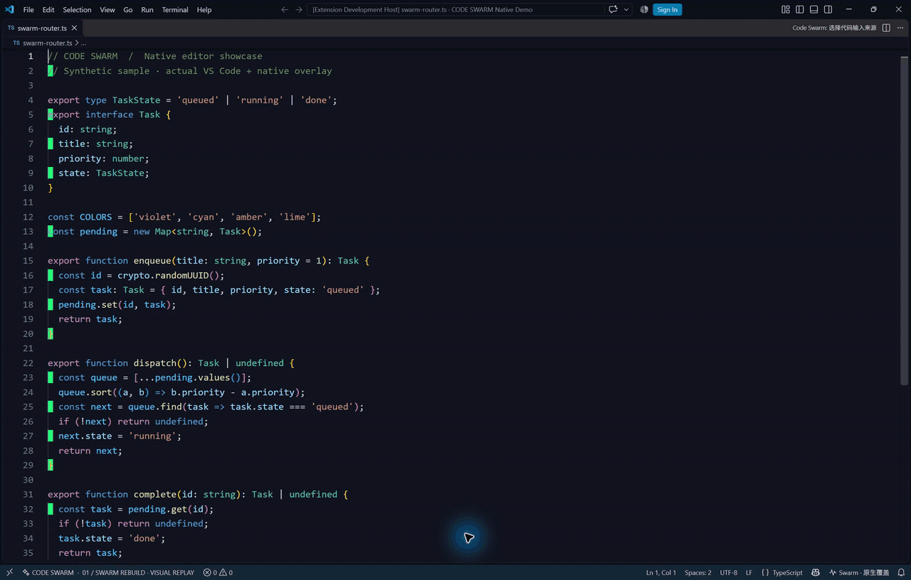

# Code Swarm

**Animated cursor swarms for code changes in VS Code.**

[中文文档](README.md) · [Download VSIX](https://github.com/luiop4/code-swarm/releases/latest) · [MIT License](LICENSE)



This GIF records the built-in read-only stage with synthetic code and a plain background. It is not a recording of model token generation or the native editor overlay.

Code Swarm is a prototype that turns code changes into cursor tasks: selecting, typing, erasing, tracing, and dragging floating code cards. On Windows, a transparent, click-through native overlay can render directly above the real editor.

## Get started

Download the VSIX from Releases, install it using **Extensions → … → Install from VSIX**, and reload VS Code. Run **Code Swarm: 播放完整演示** from the command palette to see the read-only demonstration.

### Copilot Agent integration

Open and focus a local source file. Enable **Code Swarm · 动画写入当前文件** in Copilot Agent's tool list, then explicitly reference `#swarm_animate_edit` in your request. The agent must invoke this tool before applying the same change through ordinary editing tools.

The tool receives the complete proposed file, requests confirmation, creates a backup, and progressively edits the real editor buffer through animation checkpoints. It does not receive the agent's internal token stream and does not save automatically.

### Stream from a VS Code model

Run **Code Swarm: 让 VS Code AI 流式写入当前文件**, enter a task, and select an available model. This separate command consumes the model response stream while generation is in progress and feeds it to the animated input controller.

### Observe existing edits

Run **Code Swarm: 监听当前代码文件**. This observes changes after they occur and visualizes them without delaying the original writes. Arbitrary Codex, Claude, Copilot, and external filesystem writes cannot be universally intercepted.

## Requirements and boundaries

- VS Code 1.100+; Node.js 22+ for development.
- Native overlay and animated input: Windows 10/11, .NET Framework 4.8, trusted workspace, local file.
- macOS/Linux: read-only replay stage.
- Disable word wrap and unfold the visible region for native positioning.
- One file per session; 120,000 UTF-16 characters and 2,000 lines maximum.
- User edits or competing disk changes stop pending animated input. Successful ordinary sessions support undo and keep a before-backup.
- No automatic multi-file transaction or universal AI editing hook.

## Development

```powershell
npm ci
npm run check
npm run build
code .
```

Press F5 to launch an Extension Development Host. `npm run package` builds the VSIX; `npm run preview` serves the read-only stage on loopback.

See [testing instructions](docs/TESTING.md), [adapters](docs/ADAPTERS.md), and [contribution guide](CONTRIBUTING.md). The latest Copilot integration has build/type checks but has not been validated against a live model in an end-to-end Copilot session.

Inspired by [Swarm Rebuild](https://github.com/DhvanilPatel/swarm-cursors). Independently implemented. [MIT](LICENSE); dependency notices in [THIRD_PARTY_NOTICES.md](THIRD_PARTY_NOTICES.md).
