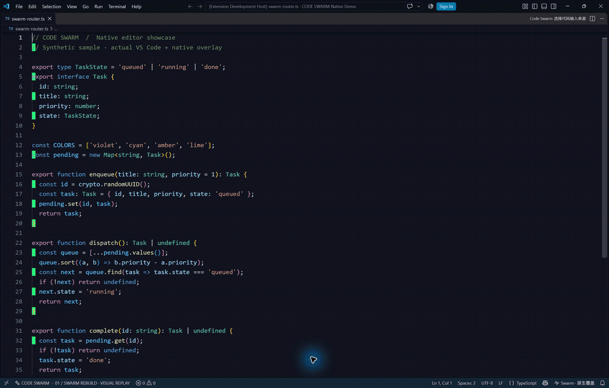

<div align="center">


**让代码的生成、修改和搬运，变成一场彩色鼠标群的协作。**

[](https://github.com/luiop4/code-swarm/releases/latest)
[](https://code.visualstudio.com/)
[](#运行要求)
[](LICENSE)

[**下载扩展**](https://github.com/luiop4/code-swarm/releases/latest) · [快速开始](docs/QUICKSTART.md) · [Copilot 接入](#在-copilot-侧栏里使用) · [English](README.en.md)

</div>

---

## 看看它如何工作



*动图录自项目自带的只读舞台，使用合成示例代码、纯色背景。它展示的是视觉演示，不是真实模型生成速度，也不是原生覆盖模式的录屏。*

Code Swarm 是一个 VS Code 扩展原型。它把代码变化拆成视觉任务，让彩色虚拟鼠标框选、输入、擦除和拖动悬浮代码卡片。Windows 下可以把点击穿透的动画层直接覆盖在真实编辑器上；也可以打开独立舞台回放。

## 三种用法

| 用法 | 适合什么情况 | 实际行为 |
|---|---|---|
| **观察现有编辑** | 继续用熟悉的 AI 或手动编辑 | 文本变化后合成动画；不会延迟或拦截原始写入 |
| **AI 实时流入** | 从扩展命令选择 VS Code 可用模型 | 持续接收模型文本，交给动画控制器逐步写入真实编辑器 |
| **Copilot 动画写入工具** | 在旁边的 Copilot Agent 聊天中使用 | Agent 提交完整结果后，扩展通过动画逐步应用编辑 |

> Copilot 工具调用不会向扩展暴露模型内部的逐 token 输出。原型也不能通用拦截任意 Codex、Claude 或外部程序已经完成的文件写入。让其他工具走动画输入，需要使用暂存通道或适配器。

## 安装

1. 从 [Releases](https://github.com/luiop4/code-swarm/releases/latest) 下载 `code-swarm-0.9.1.vsix`。
2. 在 VS Code 扩展面板右上角点击 **… → 从 VSIX 安装…**，选择下载的文件。
3. 如有提示，执行 **Developer: Reload Window**。
4. 按 `Ctrl+Shift+P`，输入 `Code Swarm` 查看全部命令。

第一次体验可运行 **Code Swarm: 播放完整演示**。它使用内置示例，不修改你的代码。

## 在 Copilot 侧栏里使用

1. 在编辑器中打开并聚焦目标本地代码文件。
2. 在 Copilot Chat 中使用 **Agent** 模式，并在工具列表启用 **Code Swarm · 动画写入当前文件**。
3. 输入 `#swarm_animate_edit` 并从补全中选择工具，然后写出修改需求，例如：

```text
#swarm_animate_edit 请在当前文件添加输入校验。
请将完整的新文件内容交给 Code Swarm 工具写入。
```

确认写入提示后，扩展会备份原文、检查目标，并逐步修改编辑器缓冲区。**内容不会由扩展主动保存**，完成后请检查代码并按需保存。

Agent 必须在普通文件编辑之前调用这个工具；如果它已经直接改完文件，工具无法追回那次写入。详见 [动画输入说明](docs/ANIMATED-INPUT.md)。

## 让 AI 生成时就流入编辑器

运行 **Code Swarm: 让 VS Code AI 流式写入当前文件**，描述任务并选择模型。模型必须由 VS Code Language Model API 提供；没有可用模型时需要先登录或启用相应模型提供方。

这个入口在模型响应过程中不断接收代码片段。动画控制器按照绘制进度提交编辑，模型输出较快时会缓冲待输入内容。它和 Copilot 侧栏工具是两个不同入口。

## 动画与编辑保护

- **混合动作**：彩色输入光标、拖选替换、红色擦除、描摹和悬浮代码卡片。
- **按需出现**：只显示正在执行任务的虚拟鼠标，完成后隐藏。
- **原生覆盖**：Windows 透明窗口点击穿透，不模拟真实鼠标或键盘。
- **版本检查**：动画输入前备份原文；人工编辑或磁盘竞争会停止后续提交。
- **可恢复**：成功完成的普通动画输入会话可整轮撤销；也能查看输入前备份。
- **独立边界**：动画进程只上报数字进度，源代码和真实编辑由扩展管理。


## 运行要求

| 项目 | 要求 |
|---|---|
| 编辑器 | VS Code 1.100+；声明的 API 最低目标不代表每个版本均已实测 |
| 原生覆盖 / 动画输入 | Windows 10/11，.NET Framework 4.8；本地文件、受信任工作区 |
| 编辑器布局 | 建议关闭自动换行，展开可见区域折叠，避免水平滚动 |
| 源码开发 | Node.js 22+、npm；Windows 构建需要 .NET Framework 编译器 |
| Python 生成器适配 | 另需 Python；普通舞台和 Copilot 工具不依赖 Python |

macOS / Linux 可使用只读回放舞台；当前原生动画输入路径面向 Windows。定位通过临时编辑器装饰与内存图像测量完成，复杂布局、失去前台或目标不可见时可能暂停。

当前原型单次输入限制为 120,000 个 UTF-16 字符、2,000 行。并不提供多文件原子事务、通用 AI 事件拦截或崩溃后自动恢复。

## 从源码启动

```powershell
git clone https://github.com/luiop4/code-swarm.git
cd code-swarm
npm ci
npm run check
npm run build
code .
```

在 VS Code 中按 **F5** 启动扩展开发宿主，再运行 `Code Swarm` 命令。打包执行 `npm run package`。

只看舞台：运行 `npm run preview`，打开终端打印的本地地址。浏览器预览只能演示视觉效果，不能监听或修改 VS Code 文件。

## 文档与开发

| 文档 | 内容 |
|---|---|
| [快速开始](docs/QUICKSTART.md) | 安装、演示、监听、暂停、备份与常见入口 |
| [动画输入](docs/ANIMATED-INPUT.md) | Copilot 工具、AI 流、暂存副本、脚本适配 |
| [适配器](docs/ADAPTERS.md) | 其他扩展如何提交预览或接入输入控制器 |
| [常见问题](docs/FAQ.md) | 为什么没有动画、为什么不能拦截全部 AI |
| [架构](docs/ARCHITECTURE.md) | 快照、任务规划、Webview 与真实编辑的边界 |
| [原生覆盖](docs/NATIVE-OVERLAY.md) | Windows 定位、点击穿透与限制；含早期版本记录 |
| [验证方法](docs/TESTING.md) | 本地检查命令和已知验证范围 |
| [更新记录](CHANGELOG.md) | 当前版本与主要演进 |
| [贡献指南](CONTRIBUTING.md) | 本地开发和提交建议 |

## 灵感与许可

视觉概念受到 [Swarm Rebuild](https://github.com/DhvanilPatel/swarm-cursors)、[Motion Canvas](https://motioncanvas.io/docs/code/) 与 [Shiki Magic Move](https://github.com/shikijs/shiki/tree/main/packages/magic-move) 启发。当前扩展、任务规划与原生动画实现为本项目独立编写。

项目采用 [MIT License](LICENSE)。运行时依赖 `diff` 的许可见 [第三方声明](THIRD_PARTY_NOTICES.md)。
